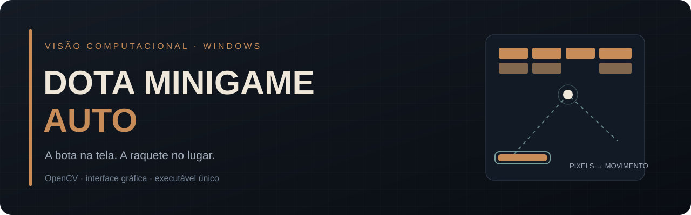
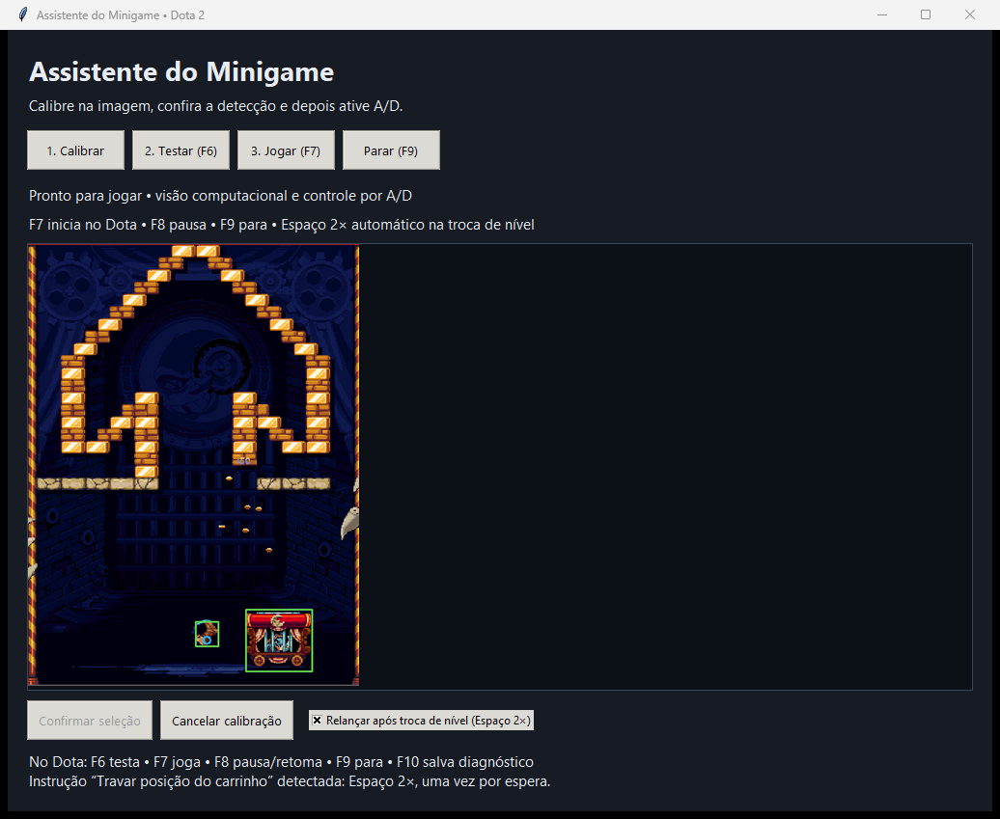

<p align="center">
  
</p>

<p align="center">
  <a href="https://github.com/Proximithy/dota-minigame-auto/releases/latest"></a>
  
  <a href="LICENSE"></a>
</p>

# Uma bota, uma raquete e alguns pixels.

[English instructions](README.en.md) • Interface em **Português / English** pelo botão com bandeira no canto superior direito.

Fiz este aplicativo para jogar automaticamente o minigame de quebra-blocos do **Dark Carnival, dentro do Dota 2**. Ele acompanha a bota na tela, calcula onde ela vai chegar e move o carrinho com **A/D**.

Quando aparece **“TRAVAR POSIÇÃO DO CARRINHO”**, reconhece a instrução e aperta **Espaço duas vezes** para liberar o próximo lançamento.

Tudo em uma interface para Windows, com um único executável. Sem instalar Python para jogar.

**v1.0.3:** botão com bandeiras para alternar Português / English, com preferência salva. Mantém as correções de rastreamento e F10 da v1.0.2. Veja o [histórico de versões](CHANGELOG.md).

## Baixar e usar

**[⬇ Baixar Dota-Minigame-Auto-Calibrado.exe](https://github.com/Proximithy/dota-minigame-auto/releases/latest/download/Dota-Minigame-Auto-Calibrado.exe)**

1. Abra o aplicativo e deixe o Dota em **janela ou janela sem bordas**.
2. Abra o minigame. O executável já inclui a calibração da configuração em que foi testado.
3. Se a resolução, escala ou posição da janela forem diferentes, clique em **Calibrar** e marque a arena, a bota e o carrinho.
4. Dentro do Dota, pressione **F7** para começar.

> A calibração embutida facilita o primeiro uso, mas não é universal. Uma nova calibração feita no seu PC passa a ter prioridade.

O botão **🇺🇸 English / 🇧🇷 Português** troca os textos imediatamente e guarda a escolha em `settings.json`, separado da calibração. O idioma da interface não altera o idioma do Dota: o relançamento automático ainda reconhece a instrução visual **em português** usada nos testes.

<p align="center">
  
</p>

## O que ele faz

- **Segue a bota:** combina cor, tamanho e movimento para localizar o objeto animado.
- **Acompanha o carrinho:** usa sua faixa visual estável, em vez de depender do corpo inteiro animado.
- **Prevê os rebotes laterais:** estima onde a bota chegará e posiciona a raquete.
- **Relança automaticamente:** reconhece a instrução da troca de nível e envia dois toques de Espaço.
- **Permite observar antes de jogar:** o modo de teste mostra a detecção sem enviar comandos.
- **Guarda diagnóstico:** F10 salva a arena, os recortes e o estado do relançamento localmente.

## Atalhos

| Tecla | Ação |
| --- | --- |
| **F6** | Iniciar observação, sem apertar A/D ou Espaço |
| **F7** | Iniciar o controle automático |
| **F8** | Pausar ou retomar o bot |
| **F9** | Parar o bot, mantendo a interface aberta |
| **F10** | Salvar um diagnóstico local |

Os comandos do jogo só são enviados com o **Dota 2 em primeiro plano**. Ao perder foco ou detecção, o aplicativo solta A/D. Use os atalhos dentro do jogo: dar Alt+Tab pode pausar o próprio minigame.

## Como funciona

```text
Captura da arena → detecção da bota e do carrinho → previsão → A/D
                 ↘ instrução de lançamento → Espaço · Espaço
```

O detector usa **OpenCV e processamento local de imagem**. A versão publicada não usa YOLO, não lê a memória do jogo e não injeta código no Dota.

A previsão cobre os rebotes laterais; colisões com blocos mudam a trajetória e são incorporadas nos quadros seguintes. Não há promessa de pontuação, vitória ou reconhecimento perfeito de todos os efeitos.

## Calibração e dados

A calibração local e os diagnósticos ficam em:

```text
%LOCALAPPDATA%\DotaMinigameAssistente
```

O aplicativo não envia essas capturas para serviços externos. Para informar uma falha, pressione **F10 durante o problema** e compartilhe apenas o diagnóstico que quiser analisar.

## Executar a partir do código

Requer **Windows e Python com Tkinter**. A versão de referência foi empacotada com Python 3.14.

```powershell
python -m venv .venv
.venv\Scripts\python.exe -m pip install -r requirements.txt
.venv\Scripts\python.exe gui.py
```

Para gerar o executável único:

```powershell
.venv\Scripts\python.exe -m pip install -r requirements-dev.txt
powershell -ExecutionPolicy Bypass -File tools\build.ps1
```

O resultado fica em `dist/Dota-Minigame-Auto-Calibrado.exe`. A receita inclui a referência de relançamento e os três arquivos de `default_calibration/`.

## Verificações

```powershell
.venv\Scripts\python.exe -m unittest -v test_i18n test_calibration test_launch_prompt test_auto_launch test_tracking test_tracking_recovery test_diagnostics test_physics
```

Os testes cobrem previsão de rebotes, seleção de direção, calibração embutida, cenas reais de diagnóstico, perdas de detecção e o relançamento. O executável também foi aberto em um ambiente gráfico isolado, inclusive com um perfil sem calibração salva. O autor confirmou o funcionamento da versão usada como base em jogo.

Essas verificações não cobrem todas as resoluções, idiomas ou situações possíveis do minigame.

## Licença e créditos

O código original deste projeto está sob a **[licença MIT](LICENSE)**. Bibliotecas, capturas e referências visuais têm seus próprios direitos: veja [THIRD_PARTY_NOTICES.md](THIRD_PARTY_NOTICES.md).

Projeto independente, sem vínculo ou endosso da Valve. Dota 2, Dark Carnival e seus elementos visuais pertencem aos respectivos titulares.
